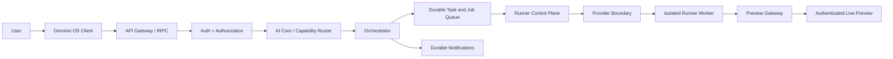

# Geminio OS Developer Handoff

## What it is

Geminio OS is an Expo/React Native AI super app with a provider-neutral AI Core and a professional Live Builder. The current product shell includes Home AI Workspace, Workspace modules, Discover, Notifications, Profile, settings, and dedicated product routes.

## Architecture



### Trust boundaries

1. **Trusted Geminio Core:** client contracts, API, authentication, persistence, orchestration, and audit data.
2. **Controlled Runner Control Plane:** policies, quotas, leases, jobs, provider adapters, diagnostics, cleanup, and preview sessions.
3. **Untrusted Generated Project:** generated source must execute only through an approved isolated provider; it must not receive host filesystem access, master credentials, internal services, or unrestricted network access.

The production container/microVM provider is intentionally not configured in this checkpoint. The application reports that boundary truthfully and does not claim executable success when the provider is unavailable.

## Frontend

- `app/` contains Expo Router screens and product routes.
- `app/(tabs)/` contains Home, Workspace, Discover, Notifications, and Profile.
- `app/live-build-studio.tsx` is the authenticated Live Builder workspace.
- `components/` contains reusable shell, layout, icon, and capability primitives.
- `hooks/` contains auth, persistence, device, and feature hooks.
- `lib/` contains client state, contracts, provider boundaries, security, and tRPC setup.
- `shared/` contains cross-layer schemas and typed contracts.

## Backend

- `server/_core/` contains Express/tRPC bootstrap, auth, OAuth, LLM, storage, and server infrastructure.
- `server/routers.ts` exposes protected Home, AI Core, notifications, Live Builder, runner, and preview procedures.
- `server/ai-core/` contains capability registry, deterministic/LLM routing, provider adapters, persistence, orchestration, gateway, security, and destination mapping.
- `server/live-builder/` contains workspace service, runtime lifecycle, runner adapter, control plane, persistence, preview gateway, and diagnostics.
- `server/geminio-data.ts` contains ownership-scoped data helpers, including notifications.

## AI orchestration

Home requests follow: request → intent → capability → permission → durable run/task/job → provider execution → validation → verified result → conversation history and notification. Ambiguous or unavailable operations are represented as explicit states. Retry budgets, leases, dead letters, checkpoints, audit metadata, and ownership checks are persisted.

## AI Builder

The Builder supports durable projects, files, versions, change sets, selections, validations, checkpoints, runtime lifecycle, diagnostics, recovery, and deployment-review boundaries. The intended workflow is:

`Create → Plan → Generate → Files → Build → Queue → Runner → Runtime → Preview → Select → AI Edit → Validate → Rebuild → Test → Version → Recover`.

Small edits are scoped to reviewed files. External deployment remains approval-gated.

## Runner control plane

`server/live-builder/control-plane.ts` defines provider-neutral scheduling and lifecycle behavior, including worker registry, resource/network policy, scoped secrets boundary, leases, heartbeat, retries, cancellation, timeout, forced stop, cleanup, structured logs, and metrics. `runner.ts` selects safe controlled development behavior or the explicit unavailable external boundary. No generated code runs inside the main application process.

## Preview

`preview-gateway.ts` manages authenticated, ownership-scoped, expiring preview sessions. The browser should connect to the preview gateway, never directly to an underlying runner. Current controlled/declarative preview behavior is safe; executable preview requires an approved isolated provider.

## Database

Drizzle/MySQL definitions are in `drizzle/schema.ts`; additive migrations are in `drizzle/*.sql`. The schema covers users, conversations, AI runs, tasks, queues, checkpoints, projects, files, versions, validations, runtime jobs, runner workers, execution logs, preview gateway sessions, artifacts, notifications, and related application domains. Run `pnpm db:push` only against an intentionally configured development or deployment database.

## Authentication and security

Protected tRPC procedures require an authenticated user and scope records by owner. Anonymous browser access receives an explicit sign-in state. Password hardening uses salted scrypt with safe legacy verification compatibility. External side effects use approval boundaries. Never place production secrets in project files; generated projects must receive only short-lived, narrowly scoped credentials through a future secrets provider.

## Navigation

The primary shell is Home, Workspace, Discover, Notifications, and Profile. Workspace product routes include AI Builder, Media Studio, Career Hub, Business Hub, Learning Hub, Wallet, Marketplace, Phone Assistant, Security Guardian, News Hub, Personal Assistant, and related modules. Product sections preserve dashboard, actions, search, history, analytics, settings, and truthful loading/empty/error states where applicable.

## Installation and commands

```bash
pnpm install
cp .env.example .env
pnpm check
pnpm lint
pnpm test -- --run
pnpm build
pnpm dev
```

- `pnpm dev`: API watcher plus Expo web/Metro.
- `pnpm release:check`: typecheck, lint, full tests, and production server build.
- `pnpm security:audit`: generate the local security audit artifact.
- `pnpm db:push`: generate/apply Drizzle migrations; use only with a safe configured database.
- `pnpm start`: start the built server.

## Current verified behavior

At checkpoint `692f21a0`, TypeScript passed, lint passed with 0 errors and 70 non-blocking warnings, the full Vitest suite reported 137 passing tests and 1 intentionally skipped authentication test, the production server build passed, API health returned 200, development services ran, and Home, Workspace, Notifications, and protected Live Builder browser routes rendered without browser console errors.

## External infrastructure still required

- Approved isolated container/microVM execution provider.
- Production preview streaming transport behind the authenticated preview gateway.
- Production credentials and provider configuration for external deployment, billing settlement, and third-party integrations.
- Authenticated browser automation credentials/fixtures for full signed-in UI E2E coverage.
